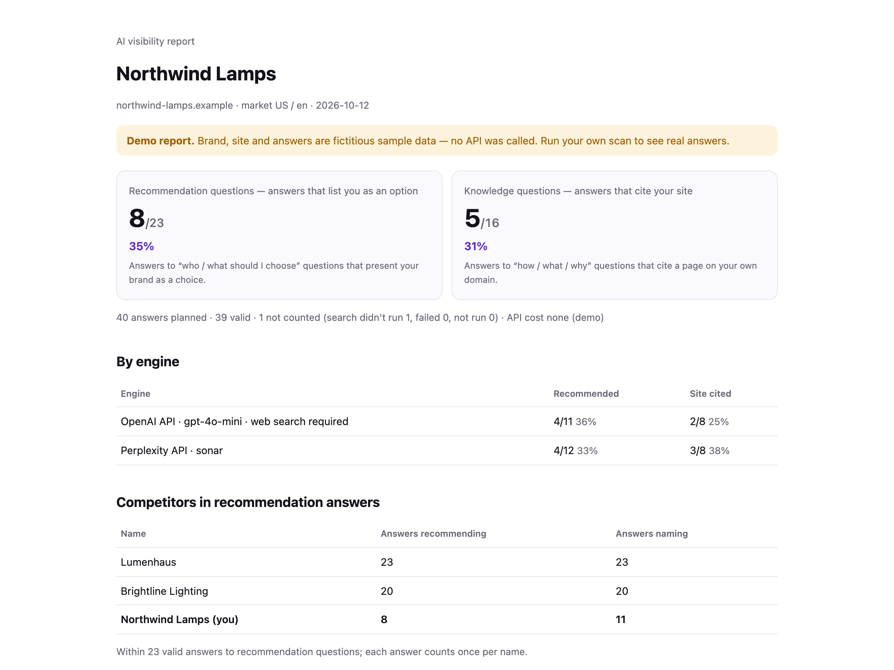

# GeoPulse Scanner

**Is your brand recommended — and is your site cited — when people ask AI search about what you sell?**

GeoPulse Scanner asks OpenAI and Perplexity (with web search) the questions your customers ask, then shows, answer by answer, whether your brand was presented as an option to choose and whether your own pages were cited — with the full answer text and sources so you can check every call yourself.

Open source (MIT). Bring your own API keys. A full scan costs about $0.35 on your own accounts.

[中文说明](README.zh-CN.md) · [How it works](docs/how-it-works.md)



<sub>Demo report built from fictitious sample answers (no API called). [Open an answer](docs/images/report-desktop-answers.png) to see the rule that fired and the sources · [50-second walkthrough (MP4)](docs/demo/geopulse-scanner-demo.mp4)</sub>

---

### Two ways to use it

| | **Run it yourself** (this repo) | **[GeoPulse Cloud](https://smrtgeo.com/?utm_source=github&utm_medium=referral&utm_campaign=oss-launch&utm_content=readme-cloud)** |
|---|---|---|
| Setup | Node.js + your own OpenAI / Perplexity keys | Use the cloud interface — no keys, no install |
| One scan: 10 questions × 2 engines × 2 samples | ✓ full scan, local HTML / JSON / CSV report | ✓ same protocol |
| Recommendation + citation evidence, raw answers | ✓ | ✓ |
| Saved history and run-to-run comparison | — you keep the files | ✓ |
| Competitor tracking, report export, content drafts | competitors per scan | ✓ |
| Runs and maintenance | you | us |

Self-hosting stays free and complete — the scanner never needs the cloud to produce a report.

---

## Quick start

Requires Node.js 20+.

```bash
git clone https://github.com/<org>/geopulse-scanner.git
cd geopulse-scanner
npm install
```

**See a report first (no API key, nothing sent):**

```bash
npm run demo
```

Open `reports/demo/report.html`.

**Run a real scan:**

```bash
cp .env.example .env        # add OPENAI_API_KEY and PERPLEXITY_API_KEY
npm run init                # writes scan.json — put in your brand, market and 10 questions
npm run scan -- --config scan.json
```

Before anything is sent, the scanner shows the number of calls and an upper-end cost estimate and asks you to confirm. `--max-usd` (default 1.50) is a hard stop for new calls.

Output in `reports/<domain>-<time>/`: `report.html` (open in a browser), `report.json` (everything, including raw answers and the model each API actually ran), `answers.csv`.

## scan.json

```json
{
  "brand": { "name": "Northwind Lamps", "domain": "northwind-lamps.example", "aliases": ["Northwind"] },
  "market": { "country": "us", "language": "en" },
  "competitors": [{ "name": "Brightline Lighting", "domain": "brightline-lighting.example" }],
  "questions": [
    { "intent": "provider_discovery", "text": "Which brands make energy-efficient LED floor lamps for home offices?" },
    { "intent": "research_citation", "text": "What does CRI mean when buying LED lighting?" }
  ]
}
```

- `provider_discovery` — a buyer looking for something or someone to choose (“which brands…”, “where can I buy…”, “who can help me…”). Scored on: **were you presented as an option?**
- `research_citation` — someone trying to understand something (“how…”, “what does…”, “is it safe…”). Scored on: **was a page on your site cited?**

Up to 10 questions; the recommended mix is 6 + 4. Write them the way your customers would, without your brand name.

## What you get

- **Two numbers, never blended:** recommendation questions — answers that list you as an option ÷ valid answers; knowledge questions — answers citing your site ÷ valid answers.
- **Every answer, openable:** full text, the rule that counted it (e.g. *option_list_item* with the exact sentence), and the citations with your own pages highlighted.
- **Failures shown as failures:** a call that errored, wasn't run, or where OpenAI's required web search didn't actually run is listed separately and kept out of the denominator — never counted as “not mentioned”.
- **Competitors** judged by the same rule.

## Cost and data flow

- Each question goes **directly from your machine** to OpenAI (Responses API, `gpt-4o-mini`, web search required) and Perplexity (`sonar`). Nothing is sent to GeoPulse; there is no telemetry.
- Requests contain only the question and short neutral instructions — **never your brand, domain or competitors** — so the answer isn't steered toward you.
- Cost of a full 40-answer scan, measured October 2026: about $0.34 on your accounts (OpenAI ≈ $0.012 per answer with search, Perplexity ≈ $0.004–0.006). The pre-run estimate is deliberately on the high side (≈ $0.80). Prices are set by the providers and can change.

## Limits — please read

- This is a **snapshot of fixed questions through the APIs**, not a ranking inside the consumer ChatGPT or Perplexity apps, and not what every user sees.
- Answers vary run to run; that's why each question is asked twice per engine. Compare two scans only when questions, engines, models and instructions are identical.
- Detection is rule-based and conservative. Every decision shows the text it was made on — check the ones that matter to you.
- No promise that changes to your site will raise these numbers.

## Support

Issues are read once a week. Security problems: please use GitHub's private **Report a vulnerability** button (Security tab) rather than a public issue.

## License

MIT © 2026 MORROW PRISM PTE. LTD. — the company behind [GeoPulse](https://smrtgeo.com/?utm_source=github&utm_medium=referral&utm_campaign=oss-launch&utm_content=readme-license) and [China Legal Hub](https://www.chinalegalhub.com/?utm_source=github&utm_medium=referral&utm_campaign=clh_referral&utm_content=scanner-readme), fixed-price legal help for businesses buying from or selling into China.
